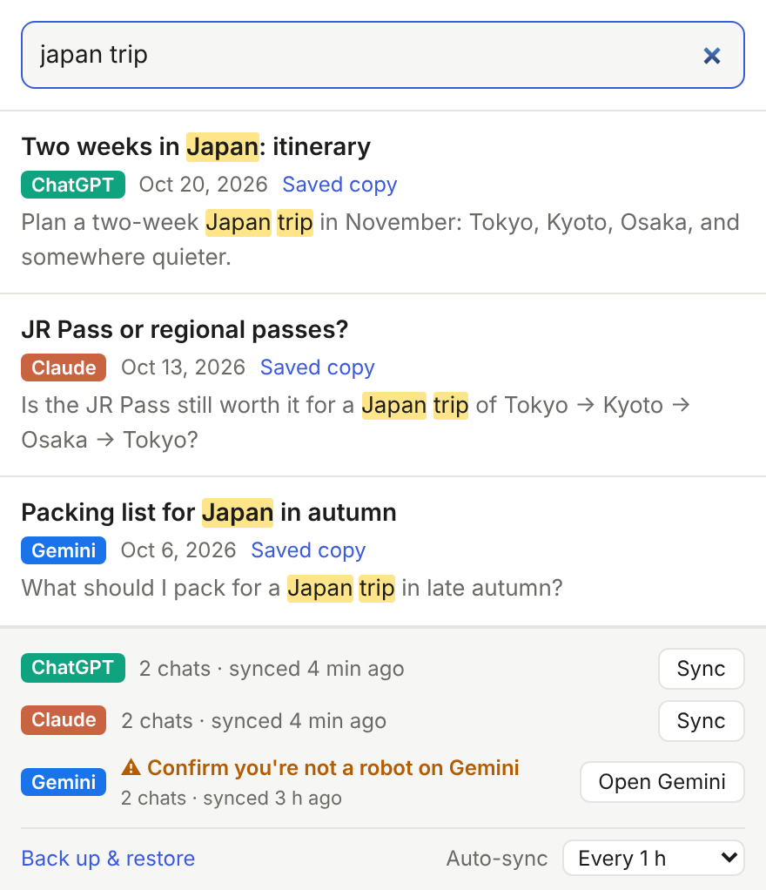
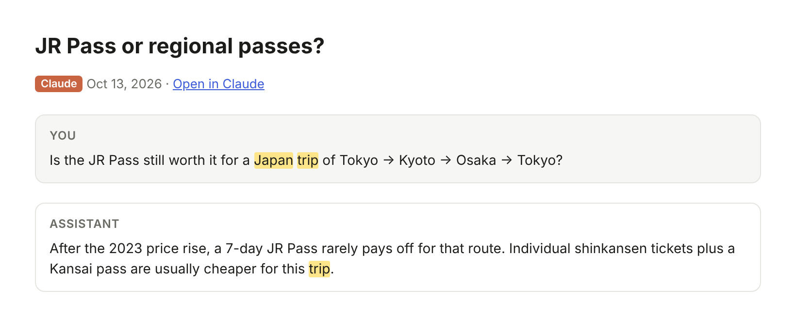
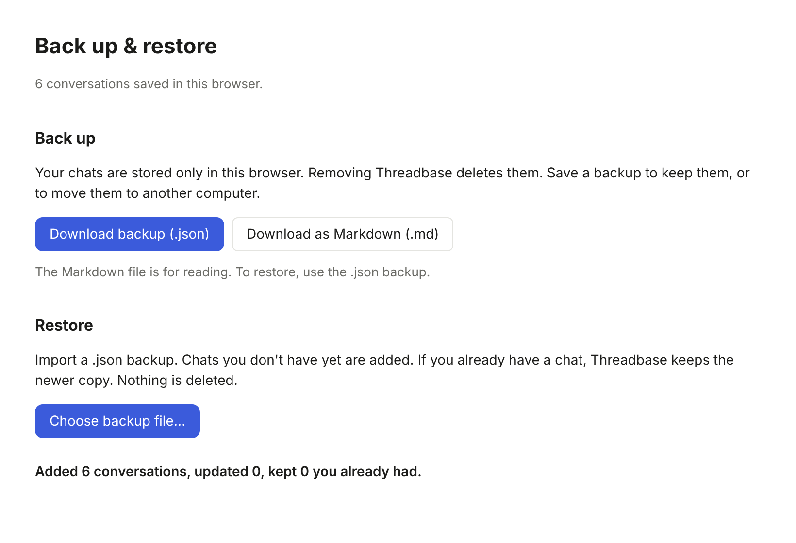
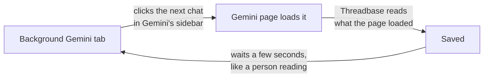
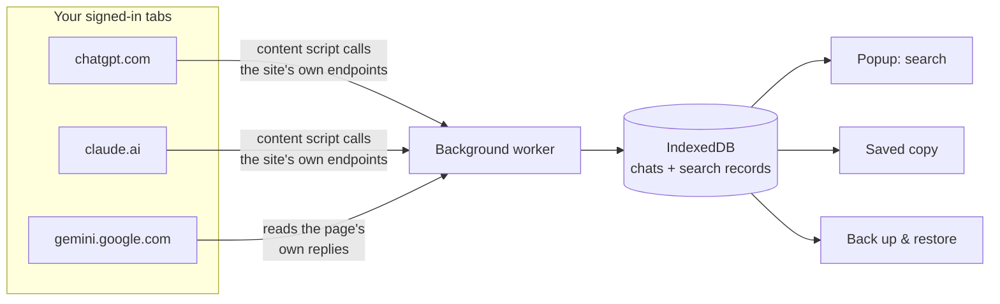

<div align="center">


# Threadbase

**Search all your ChatGPT, Claude and Gemini chats in one place.**

[](https://github.com/huan0925/Threadbase/releases/latest)
[](https://github.com/huan0925/Threadbase/actions/workflows/ci.yml)
[](LICENSE)

[Install](#install) · [How to use](#how-to-use) · [FAQ](#faq) · [Privacy](#privacy)



</div>

> *"I asked an AI about this months ago… was it ChatGPT? Claude? Gemini?"*

Threadbase is a Chrome extension that quietly keeps a copy of your AI
conversations and lets you search all of them at once.

<table>
<tr>
<td width="33%" valign="top">

### 🪄 No setup
Stay signed in to the sites as usual. No exports, no API keys: Threadbase
syncs through your own browser.

</td>
<td width="33%" valign="top">

### 🔒 Stays on your computer
Your chats are stored in the extension, in this browser. Nothing is sent to
any server.

</td>
<td width="33%" valign="top">

### 🌏 Every language
Matches any part of the text, so 中文 and 日本語 searches work as well as
English ones.

</td>
</tr>
<tr>
<td valign="top">

### 🔄 Always up to date
Syncs when you open a site, on a schedule, or when you press **Sync**.

</td>
<td valign="top">

### 📖 Saved copies
Read any chat inside Threadbase, with your search terms highlighted, even
after you delete it on the site.

</td>
<td valign="top">

### 💾 Back up & restore
Download everything as one file, and restore it on another computer.

</td>
</tr>
</table>

## 🧩 Supported services

| | Service | How it syncs | First sync |
|---|---|---|---|
| ✅ | **ChatGPT** · chatgpt.com | Direct, from the site's tab | ⚡ Fast: many chats a minute |
| ✅ | **Claude** · claude.ai | Direct, from the site's tab | ⚡ Fast: many chats a minute |
| ✅ | **Gemini** · gemini.google.com | Opens each chat in a background tab | 🐢 About 5 s per chat ([why?](#why-is-gemini-slower)) |
| 🔜 | Perplexity, Copilot, Grok, DeepSeek | | [Backlog](BACKLOG.md) |

Chats from the services' phone and desktop apps are included too, since
they're part of your account.

<a name="install"></a>

## 📦 Install

> Threadbase isn't in the Chrome Web Store yet, so it's installed by hand.
> It takes about a minute, in Chrome, Edge, Brave, Arc or any other
> Chromium-based browser.

1. **Download** `threadbase-extension.zip` from the **Assets** of the
   [latest release](https://github.com/huan0925/Threadbase/releases/latest).
   Don't download "Source code".
2. **Unzip it** into a folder you'll keep. The browser loads Threadbase from
   that folder, and it should contain `manifest.json` directly.
3. Open **`chrome://extensions`** and turn on **Developer mode** (top right).
4. Click **Load unpacked** and pick the folder.
5. **Pin it**: puzzle-piece icon in the toolbar → 📌 next to Threadbase.

### Updating

> [!WARNING]
> **Never click Remove to update.** Removing an extension deletes all its
> saved chats, even if you reinstall it right after.

1. Download the new zip and **unzip it over the old folder**.
2. In `chrome://extensions`, click **↻ reload** on Threadbase's card.

That's it. Your chats are kept.

<details>
<summary><b>Moving the folder, removing the extension, or updating from v0.6.0 or earlier</b></summary>

**Moving or renaming the folder.** Threadbase can't load from its old
location anymore. Right away, click **Load unpacked** and pick the folder
in its new place. Your chats are kept, because they belong to Threadbase's
extension ID, and that stays the same wherever the folder is. To be safe,
download a backup first.

**If you must remove the old version**, back up first:

1. In the old version, open **Back up & restore** (bottom of the popup) →
   **Download backup (.json)**.
2. Remove the old version, then **Load unpacked** the new one.
3. In the new version, open **Back up & restore** and choose the backup
   file. It takes seconds, and nothing is downloaded from the sites again.

**From v0.6.0 or earlier to v0.6.1 or later** (one time only). Older
versions had no fixed extension ID, so the new version starts empty. Bring
your chats over like this:

1. Download a backup from the old version.
2. Load the new version from a **new** folder.
3. Restore the backup in the new version.
4. Remove the old version.

</details>

<a name="how-to-use"></a>

## 🚀 How to use

**1. Open each site once while signed in:** [chatgpt.com](https://chatgpt.com),
[claude.ai](https://claude.ai), [gemini.google.com](https://gemini.google.com).
Threadbase syncs your history in the background, and you can keep using
the site meanwhile.

**2. Click the Threadbase icon and type.**

- Every word must appear somewhere in the chat. Use `"double quotes"` to
  keep a phrase together.
- Click a **title** to continue the chat on its site.
- Click **Saved copy** to read it inside Threadbase:

<p align="center"></p>

**3. That's all. It stays up to date by itself:**

| When | What syncs |
|---|---|
| 🌐 You open a site | New and changed chats (at most every 10 min) |
| ⏰ Every hour while Chrome is open | All services, quietly in background tabs. Change it under **Auto-sync**: 30 min to 6 h, or off |
| 👆 You press **Sync** | That service, right away |

**When Threadbase needs you**, the popup shows ⚠ in orange. The Gemini row
in the screenshot above is an example.

- **⚠ Sign in to …**: sign in on that site, then press **Sync**.
- **⚠ Confirm you're not a robot on Gemini**: click **Open Gemini**, finish
  Google's check, then press **Sync**. It carries on where it left off.
  Threadbase never answers these checks for you.

### 💾 Back up your chats

Your chats live only in this browser. Click **Back up & restore** at the
bottom of the popup:

- **Download backup (.json)** saves everything, so you can restore it later
  or on another computer.
- **Download as Markdown** gives you one readable file of all your chats.
- **Restore** adds chats you don't have, keeps the newer copy of the ones
  you do, and never deletes anything.

<p align="center"></p>

<a name="faq"></a>

## ❓ FAQ

<a name="why-is-gemini-slower"></a>
<details>
<summary><b>Why is Gemini slower than ChatGPT and Claude?</b></summary>

<br>

**ChatGPT and Claude** load your chats with plain requests to the site.
Threadbase sends the same requests from the site's own tab, using your
signed-in session, so it's fast and needs no extra tab.

**Gemini only answers its own page.** Google rejects Gemini requests that
weren't made by the Gemini page's own code. Threadbase tried sending them
itself, with the page's tokens and headers, and every one was turned down.
So instead it works alongside the page:



What this means for you:

- 🐢 **The first sync is slow**: about 5 seconds per chat, so 100 chats take
  roughly 10 minutes. After that, only new and changed chats are opened.
- 🗂️ **A Gemini tab is open while it syncs.** Leave it alone; it closes by
  itself when done.
- 🤖 **Google may ask for a robot check.** The sync stops and shows you the
  tab, and you finish the check yourself.
- ⚡ **Chats you open yourself are saved instantly**, since the page loads
  them anyway.
- 🔧 **Gemini is the most likely to break.** Its data is unlabeled lists of
  values, read by position. When Google changes the page, Gemini sync may
  need a Threadbase update.

</details>

<details>
<summary><b>Which chats are included?</b></summary>

<br>

Whatever each site's **web version** shows in its history, for the account
signed in on that site in this browser.

| ✅ Included | ❌ Not included |
|---|---|
| Chats from the phone and desktop apps | ChatGPT Temporary Chats, Claude incognito chats, and Gemini chats made with Gemini Apps Activity off (the services don't keep them) |
| Chats you later delete on the site (Threadbase keeps its copy) | Other accounts. For Gemini with several Google accounts, only the default one |
| | Chats deleted on the site before Threadbase saved them |
| | Not yet: ChatGPT archived chats, ChatGPT Projects, images and files ([Limitations](#limitations)) |

</details>

<details>
<summary><b>"Manifest file is missing or unreadable" when loading</b></summary>

<br>

The folder you picked isn't the extension. Either you downloaded "Source
code" instead of `threadbase-extension.zip`, or you picked the folder one
level above `manifest.json`.

</details>

<details>
<summary><b>Will search stay fast with thousands of chats?</b></summary>

<br>

Yes. The popup doesn't load your chats when it opens. Searches start with
the newest chats and stop once they have 50 results. With 20,000 chats, a
typical search takes well under a second. A search that matches nothing
has to read everything, which takes a few seconds at that size.

</details>

<a name="privacy"></a>

## 🔒 Privacy

- 🏠 **Your chats stay in your browser**, in the extension's own storage
  (IndexedDB). Backups are files you download yourself; nothing is uploaded
  anywhere.
- 🌐 **It only talks to chatgpt.com, claude.ai and gemini.google.com**, from
  the sites' own tabs, using your existing session, just like the sites'
  pages do. Threadbase never sees your password.
- 🔑 **Minimal permissions**: access to those three sites, plus storage and
  scheduling.
- 🔍 **On gemini.google.com**, a small script inside the page reads the
  replies to the page's own requests that list and load chats. In the
  background sync tab, it also asks those requests for more chats per page.
  It doesn't read or change anything else.

<a name="limitations"></a>

## ⚠️ Limitations

- Threadbase uses the same internal endpoints the sites' own pages use, not
  official APIs. If a site changes them, syncing that site breaks until
  Threadbase is updated. Please
  [open an issue](https://github.com/huan0925/Threadbase/issues) if it does.
- **Gemini:**
  - Only the reply draft you chose is saved.
  - Very long chats (over 100 turns) may be saved only in part.
- **ChatGPT:** archived chats and chats in Projects may not be included yet.
- Images and files aren't saved, only text.
- Chats you delete on a site stay in Threadbase.
- Firefox and Safari aren't supported yet.

## 🗺️ Roadmap

- [x] ChatGPT, Claude and Gemini
- [x] Automatic and scheduled sync
- [x] Back up & restore
- [x] Fast search for large histories
- [ ] Chrome Web Store listing (one-click install and automatic updates)
- [ ] More services: Perplexity, Copilot, Grok, DeepSeek
- [ ] Firefox

The full list is in [BACKLOG.md](BACKLOG.md).

<details>
<summary><h2>🛠️ For developers</h2></summary>

### How it works



| Path | Purpose |
| ---- | ------- |
| `src/providers/` | One client per site: list conversations, fetch one, normalize it. |
| `src/sync.ts` | Downloads only conversations that are new or changed since the last sync. |
| `src/content/` | Runs in each site's tab and syncs with the user's session. |
| `src/content/gemini-page.ts`, `src/gemini-backfill.ts` | Gemini: read the page's own replies, steer the background sync tab. |
| `src/background.ts` | Stores conversations, tracks sync status, opens a tab when Sync is pressed. |
| `src/search.ts` | Search records (compact lowercased text) and matching; the popup scans them newest first. |
| `src/backup.ts` | Backup files: export, validate, merge on import, Markdown. |
| `src/ui/` | The popup, the saved-copy viewer, and the backup page. |

Conversations are stored as trees, because editing or regenerating a
message creates branches. The viewer shows the branch you last saw.

### Build and test

Requires Node.js 22.18 or newer.

```sh
npm install
npm run build        # builds the extension into dist/; load that folder unpacked
npm run watch        # rebuilds on change; then reload the extension
npm test             # unit tests (node:test)
npm run typecheck
npm run test:e2e     # loads dist/ into Chromium against fake chatgpt.com, claude.ai and gemini.google.com
node scripts/screenshots.mjs   # retakes the README screenshots from made-up chats
```

The end-to-end tests need Playwright's Chromium (`npx playwright install
chromium`) and `openssl`.

### Adding a service

1. Add a client in `src/providers/<service>.ts` implementing
   `ProviderClient` (`src/sync.ts`): list conversations newest first, fetch
   and normalize one.
2. Add a content script in `src/content/`, an entry in `scripts/build.mjs`,
   and the site to `public/manifest.json` (content script and
   `host_permissions`).
3. Add the source to `SourceId` in `src/types.ts` and to the popup.
4. Add tests with an anonymized sample response under `test/fixtures/`.
   Never commit real conversations.

To learn a site's internal API without sharing anyone's chats, record the
site's traffic in DevTools (Network → Export HAR, sanitized) and run
`node tools/har-shape.mjs recording.har <host>`. It prints the structure of
every JSON and batchexecute call with all text masked to its length. Delete
the HAR file afterwards; it contains the conversations.

### Releasing

Bump `version` in `package.json`, then open **Actions → Release → Run
workflow**. It runs all tests and publishes `threadbase-extension.zip` as a
GitHub Release.

</details>

## 🙏 Acknowledgements

Gemini's internal API details (RPC ids, request headers, response
positions) were cross-checked against
[HanaokaYuzu/Gemini-API](https://github.com/HanaokaYuzu/Gemini-API), a
reverse-engineered Python client for the Gemini web app.

## 📄 License

[MIT](LICENSE)
